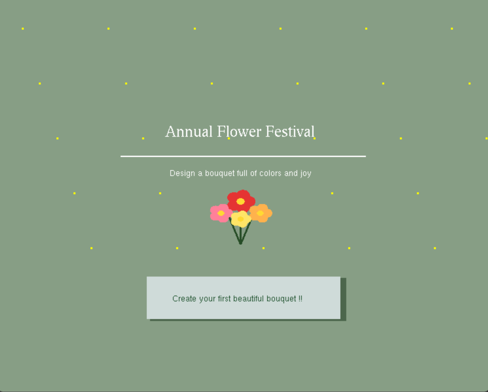
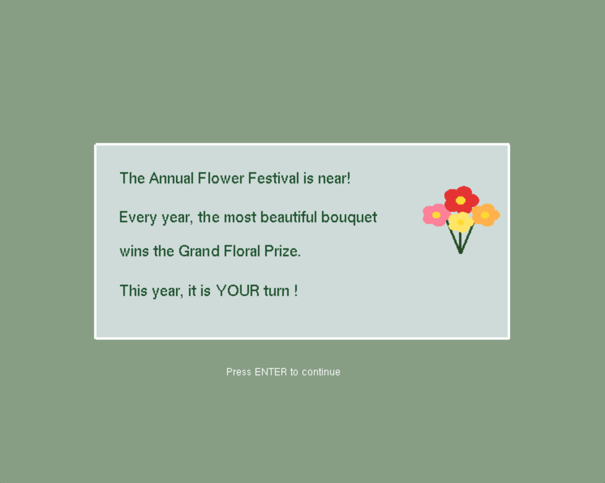
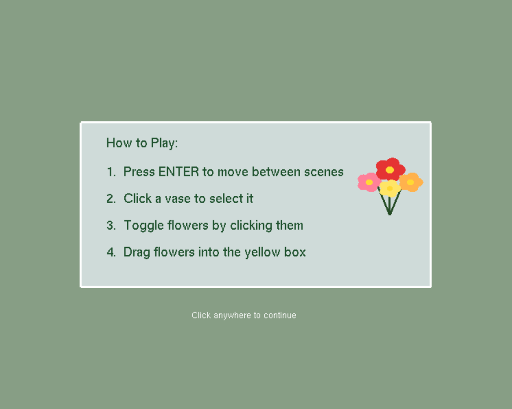
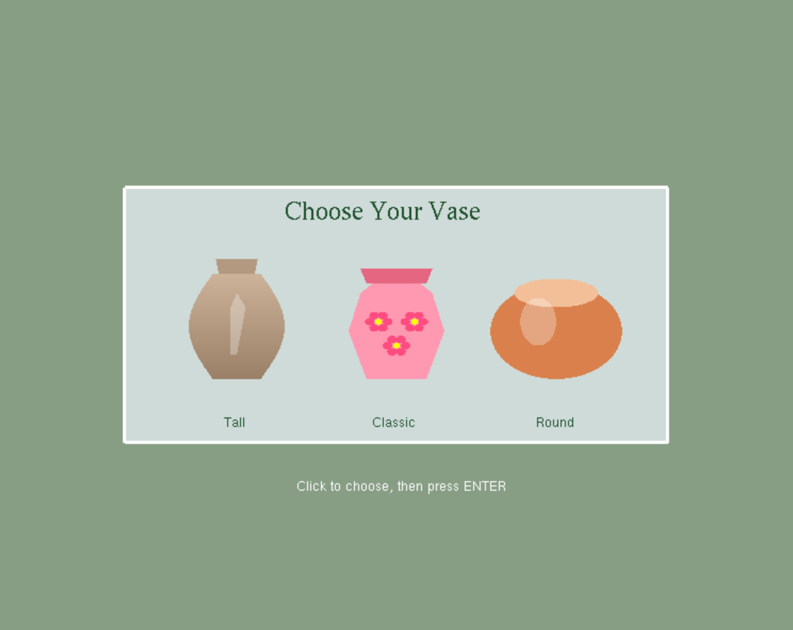
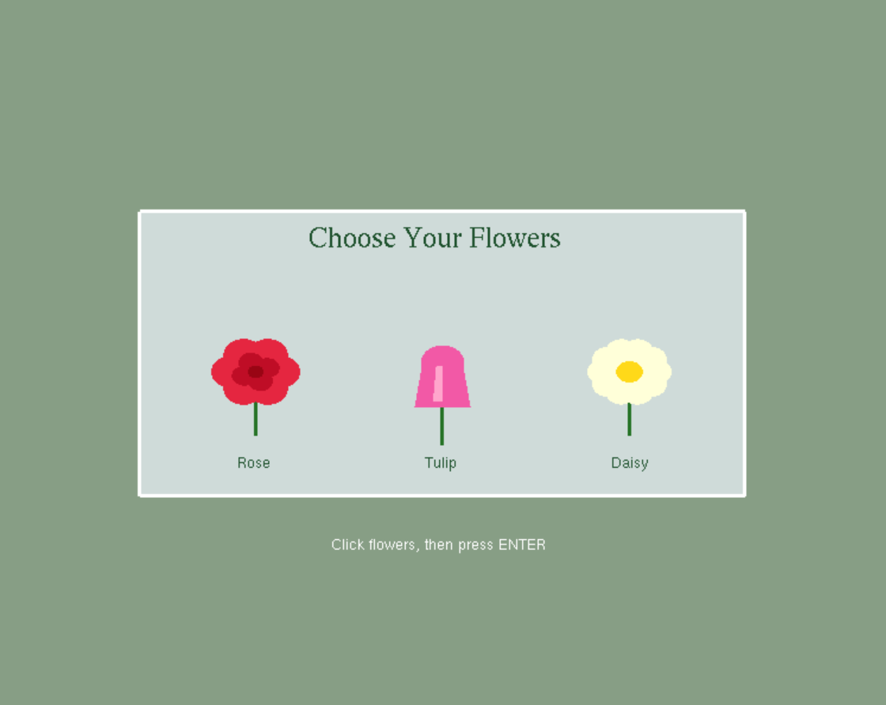
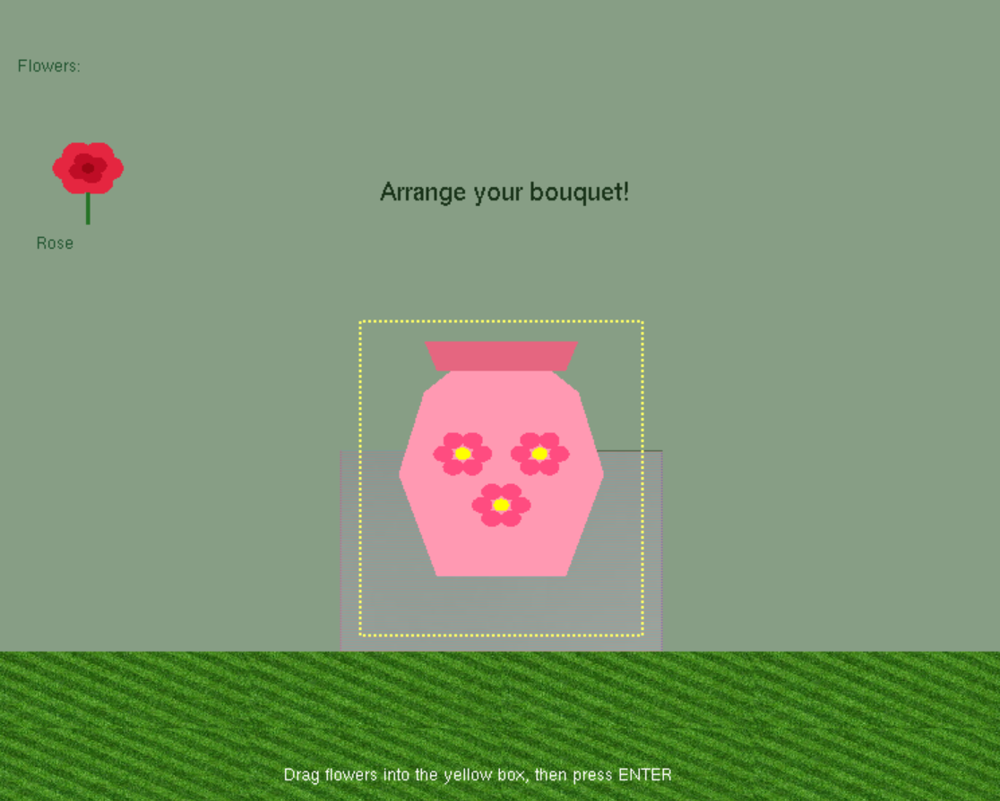

# 🌸 Flower Festival (2D OpenGL Game)

  
  
  

  
  
  

A 2D interactive graphics and arrangement game built with **C++** and **OpenGL (GLUT)**. Players navigate through aesthetic botanical displays, manage flower selections, and interact with custom 2D transformations.

---

## 🎮 Game Overview & Features

**Annual Flower Festival** is an interactive 2D story-based game where players craft a custom floral bouquet to win the grand festival competition. 

The application features a smooth **7-stage interactive journey**:
1. **Splash Screen:** Welcomes players with animated titles and sparkling effects.
2. **Story & Instructions:** Sets the narrative and guides users through the controls.
3. **Vase & Flower Selection:** Lets players choose from 3 vase styles (Tall, Classic, Round) and flowers like Roses, Tulips, and Daisies.
4. **Bouquet Arrangement:** Uses intuitive drag-and-drop mechanics inside a textured environment.
5. **Final Result:** Displays the masterpiece enhanced with scaling, rotation, and particle animations.

---

## ⌨️ Controls & User Interaction

| Input / Key | Action / Function |
| :--- | :--- |
| **ENTER** | Move between scenes / Progress dialogue |
| **ESC** | Exit the program |
| **Left-Click** | Select objects, vases, or flowers |
| **Mouse Hover** | Highlight buttons and interactive UI elements |
| **Drag & Drop** | Place and arrange flowers inside the vase box |

---

## 📐 Technical & Graphic Highlights

- **Drawing Primitives:** Utilized custom shape functions with OpenGL primitives including `GL_POLYGON`, `GL_TRIANGLE_FAN`, `GL_LINES`, `GL_POINTS`, and `GL_QUADS`.
- **Geometric Transformations:** 
  - *Translation (`glTranslatef`):* Moved dragged flowers, animated objects, and orbiting elements.
  - *Scaling (`glScalef`):* Implemented pulsing vase animations and flower resizing.
  - *Rotation (`glRotatef`):* Applied rotation matrices for decorative elements in the final scene.
- **Texture Mapping:** Integrated BMP texture files for realistic grass and petal environments.
- **Transparency & Blending:** Configured blending functions (`glBlendFunc`) for glass reflections and UI panels.
- **Sound Effects:** Incorporated auditory feedback using the Windows Beep function for object selections and scene transitions.

---

## 🛠️ Built With

- **Language:** C++
- **Graphics Libraries:** OpenGL, GLUT

---

## 🚀 How to Run

1. Open the project solution in your C++ IDE configured with OpenGL and GLUT.
2. Ensure all source files and texture assets are placed correctly within the project directory.
3. Compile and execute the main program file.

---

## 🏫 Academic Context

> This project was developed as a course project within a constrained timeframe. While created under academic workload pressure, it successfully implements all required Computer Graphics concepts, 2D transformations, and core game logic features effectively. 

---

## 👥 Team Contributions

| Member Name | Task |
| :--- | :--- |
| **Reem Alzahrani** | Developed the Start Screen scene, implemented Texture Mapping and Sound Effects, prepared the Presentation slides, and edited the Project Report. |
| **Ritaj Ayman** | Developed the Vase Selection Scene and implemented Translation Transformations. |
| **Shaimaa Alshareef** | Developed the Flower Selection Scene, the Flower Arrangement Scene inside the vase, and prepared the Project Report. |
| **Lana Alsalmi** | Developed the Final Bouquet Display Scene and implemented Scaling and Rotation Transformations. |
